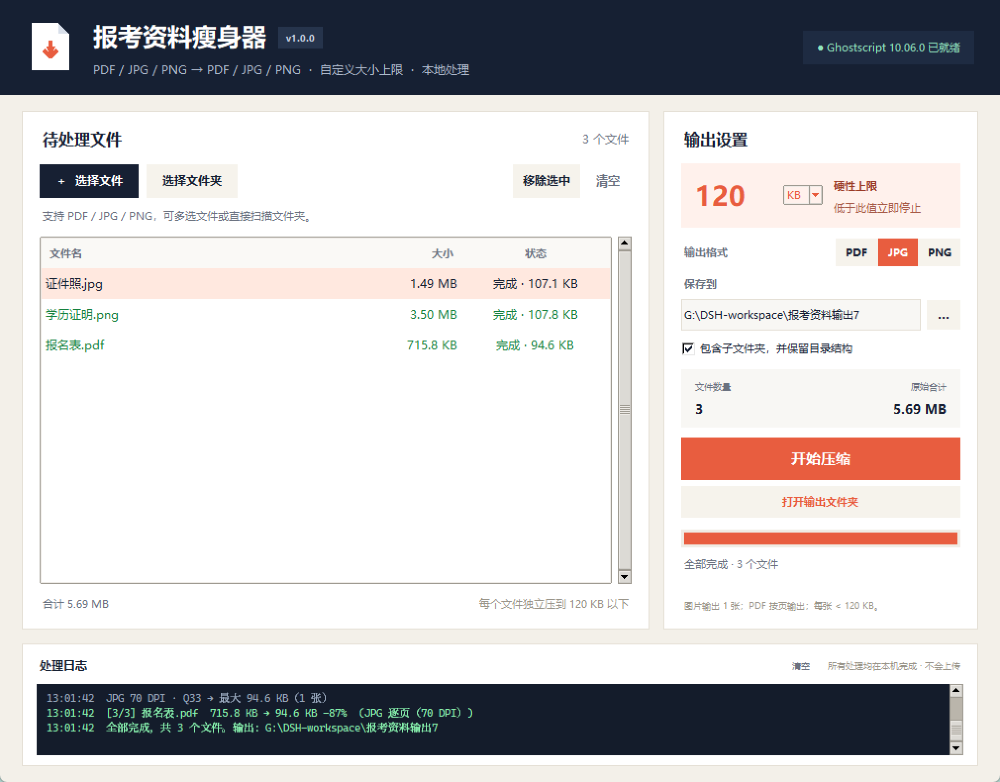

# 报考资料瘦身器 v1.0.0

一个 Windows 上开箱即用的资料压缩工具。支持 **PDF / JPG / PNG** 输入，输出可选 **PDF / JPG / PNG**，大小上限由你自己填写，支持 **KB / MB**。



## 下载便携版

从 GitHub Releases 下载：

```text
ExamMaterialSqueezer-v1.0.0-portable.exe
```

- 双击即可运行，不需要安装 Python。
- 已内置 Pillow 和 Tkinter。
- PDF 压缩仍然需要系统安装 Ghostscript（图像输入不需要）。
- 便携版不会写入注册表，删除 exe 即可卸载。

## 功能

- 输入支持：PDF、JPG、JPEG、PNG
- 输出支持：PDF、JPG、PNG
- 单文件、多文件、整个文件夹批量处理
- 大小上限自由填写，单位可选 KB 或 MB（默认 200 KB）
- 文件夹模式支持包含子文件夹，并保留原有目录结构
- 图片输入可以直接压成 JPG/PNG，也可以转成单页 PDF
- PDF 输入可以保留 PDF，也可以逐页输出 JPG/PNG
- 多页 PDF 转图片时逐页输出，不会丢页
- 已完成文件自动跳过：后续导入新文件再点开始，只处理新增/未完成的文件
- 修改大小上限、输出格式或输出目录后，已完成的文件会按新设置重新处理
- 待处理列表支持**单个移除**：选中一行后点「移除选中」，或按 Delete
- 输出到新的文件夹，自动命名
- 全程本地处理，不上传文件
- Ghostscript 自动检测

## 从源码运行

系统要求：Windows 10/11、Python 3.10+、Ghostscript 10.x（已在 10.06.0 上测试）、Pillow 10.1+。

```bat
pip install -r requirements.txt
run.bat
```

也可以直接运行：

```bat
python app.py
```

如果双击 `run.bat` 没有反应，请在该目录打开终端运行 `python app.py`，以便看到具体报错。

Ghostscript 会从以下位置自动查找：

- 环境变量 `EXAM_SQUEEZER_GS`、`PDF_SQUEEZER_GS`、`GS_PATH`、`GHOSTSCRIPT_PATH`
- 系统 `PATH`
- `C:\Program Files\gs`、`C:\Program Files (x86)\gs`、`G:\gs`、`C:\gs`、`D:\gs`

如果找不到，右上角状态会变红。安装 Ghostscript 后点击状态标签即可重新检测。图片输入在缺少 Ghostscript 时仍然可用。

> PDF 压缩不依赖 Pillow；只有处理 JPG/PNG 输入时才需要。缺少 Pillow 时会显示安装提示。

## 使用

1. 点「选择文件」选 PDF/JPG/PNG，或点「选择文件夹」批量扫描。
2. 在右侧输入大小上限，并选择 `KB` 或 `MB`（支持小数，例如 `0.2 MB`）。
3. 选择输出格式：PDF、JPG 或 PNG。
4. 确认输出文件夹。
5. 点「开始压缩」；完成后可点「打开输出文件夹」。

删除某个待处理文件：在列表中选中它，点「移除选中」，或直接按 Delete。

### 输入和输出的组合

| 输入 | 输出 PDF | 输出 JPG | 输出 PNG |
|---|---|---|---|
| PDF | 保留 PDF，多页仍是多页 | 每页一张 JPG | 每页一张 PNG |
| JPG/PNG | 转成单页 PDF | 重新压成 JPG | 重新压成 PNG |

图片输入转 PDF 时，会按图片原始 DPI 生成一页 PDF；没有 DPI 信息时按 96 DPI 处理。

### 已完成文件不会重复压缩

- 一批文件完成后，再添加新文件并点「开始压缩」，只会处理新增文件。
- 已完成的文件会保留「完成」状态，不会重新压一遍。
- 如果修改了大小上限、输出格式或输出目录，已完成文件会按新设置重新处理。
- 想彻底重来：点「清空」后重新选择。

## 输出命名

- 普通输出：`源文件名_压缩_YYYYMMDD_HHMMSS.pdf` / `.jpg` / `.png`
- 多页 PDF 转图片：`源文件名_压缩_YYYYMMDD_HHMMSS_第01页.jpg`、`_第02页`……

同名文件已存在时会自动追加 `_2`、`_3`，不会覆盖旧文件。

## 压缩策略

所有输出都必须严格小于你设置的上限，达到目标就停止。

### PDF 输入

1. 原文件已经小于上限：直接复制，质量不变。
2. Ghostscript 智能压缩：下采样图片、重编码、压缩字体，尽量保留文字和矢量。
3. 逐页转 JPEG，再重新拼成 PDF：文件大小由 DPI 和 JPEG 质量决定，逐步下探。
4. 继续降低 DPI 和 JPEG 质量到极低值。
5. 页数过多、以上仍不达标时：把所有页面缩小后拼成 **1 页缩略图总览**，页数直接降为 1，再压缩这张总览图。

第 5 步是为几百页、上千页的极端文件准备的兜底方案。输出仍然是一页 PDF，但每页只剩很小的缩略图，基本不可阅读，只用于满足大小限制。

### 图片输入（JPG/JPEG/PNG）

1. 用 Pillow 读取并校正 EXIF 方向，透明区域铺白底。
2. 按目标大小估算初始缩放比例，再逐步降低尺寸。
3. JPG：同时降低 JPEG 质量，直到低于上限。
4. PNG：降尺寸并逐步减少颜色数（256/128/64/32/16/8 色），直到低于上限。
5. 输出 PDF：先把图片压成 JPEG，再嵌入单页 PDF，并检查最终 PDF 大小。

图片输入和 PDF 输入可以混合放在同一批里处理。

## 构建便携版

```bat
pip install -r requirements-build.txt
python build_portable.py
```

输出：

```text
dist/ExamMaterialSqueezer-v1.0.0-portable.exe
dist/ExamMaterialSqueezer-v1.0.0-portable.exe.sha256
```

`build_portable.py` 使用 PyInstaller 打包，图标、`assets` 和 Pillow 都会一起带入。推送 `v1.0.0` 标签后，`.github/workflows/release.yml` 会在 Windows runner 上自动构建并上传 Release 附件。

## 说明

- 大小按二进制单位计算：1 KB = 1,024 字节，1 MB = 1,048,576 字节。
- 上限最小为 1 KB；输入非法或过小时会提示。
- 为达到目标，链接、表单、书签、注释可能丢失；这是极限压缩的正常代价。
- JPG/PNG 模式为降低体积会降低分辨率；文字类资料建议在电脑上放大确认后再上传。
- 加密 PDF 暂不支持，会显示失败原因。
- 原文件永远不会被修改或删除。
- 处理在后台线程中进行，界面不会卡死；可随时停止，已生成的文件会保留。

## 项目结构

```text
exam-material-squeezer/
├── app.py                    # 入口，只负责启动 UI
├── compressor.py             # 旧接口兼容层，新代码用 core
├── core/
│   ├── __init__.py           # 对外 API
│   ├── config.py             # 大小/DPI/质量降级配置
│   ├── models.py             # 结果与异常模型
│   ├── ghostscript.py        # Ghostscript 查找与版本
│   ├── image_ops.py          # JPG/PNG 输入处理
│   ├── pdf_builder.py        # JPEG → PDF、缩略图总览 PDF
│   └── engine.py             # 压缩流程编排
├── ui/
│   ├── __init__.py
│   ├── theme.py              # 配色、版本号
│   └── main_window.py        # Tkinter 主窗口
├── packaging/
│   └── version_info.txt      # Windows 文件版本信息
├── .github/workflows/
│   └── release.yml           # 自动构建 Release
├── build_portable.py         # 便携版构建脚本
├── requirements.txt
├── requirements-build.txt
├── run.bat
├── assets/
│   ├── icon.ico
│   └── screenshot.png
├── CHANGELOG.md
├── LICENSE
├── README.md
└── pyproject.toml
```

## License

MIT
